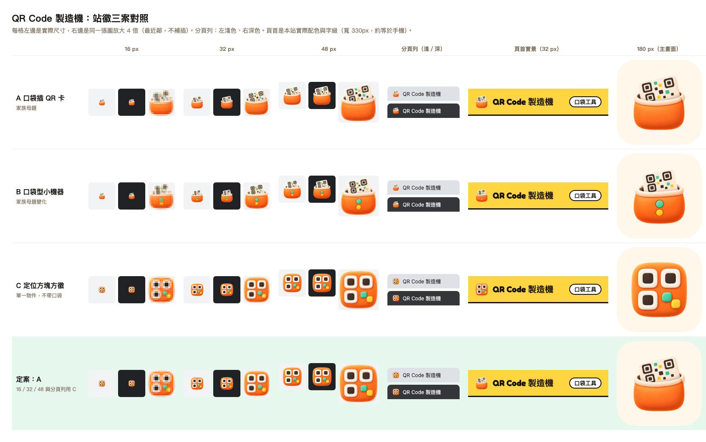

# QR Code 製造機的站徽

2026 年 9 月 26 日產品由 QR Code Studio 改名為 **QR Code 製造機**（英文 QR Code Maker），網址 `/qrcode-studio/` 不變，同時換上新的站徽。

## 設計方向

口袋工具的每個工具都用同一個母題：**口袋裡裝著這個工具的招牌物件**。口袋工具本身的圖示是水獺爪子從口袋探出來，
其他工具的口袋裡則放著各自的東西。風格是圓潤的軟陶感插畫，光從左上來，輪廓厚實，不含任何文字或字母。
口袋用本站的品牌橘 `#FF7A1A`，物件用對比的奶油白，點綴本站的糖果色（薄荷綠 `#36D399`、陽光黃 `#FFD12E`），
細節用深可可色。

站徽是點陣圖，由圖片生成模型產生三案再挑一案：這種插畫的厚實感與柔和明暗，手描向量做不出來。
圖上的 QR 圖案只有三個定位方塊與幾格色塊，**刻意不是掃得出來的真碼**（每張正本都用站上同一版解碼器確認過讀不到東西）。

## 三案與選擇



| 案 | 內容 | 結果 |
|---|---|---|
| A | 口袋裡插著一張 QR 卡 | **採用**：頁首、主畫面圖示、manifest、分享圖 |
| B | 口袋型的小機器吐出一張 QR 卡，機身有兩顆按鈕 | 未採用，原圖留在 [`candidate-b.png`](./candidate-b.png) |
| C | 三個定位方塊組成的圓角方徽，不帶口袋 | 當 A 的**分頁圖示簡化版**（favicon） |

比較順序是：32 px 還認不認得出物件，16 px 有沒有糊成一團，跟本站的黃色頁首與品牌橘協不協調，跟口袋工具其他工具是不是一家。

- **A 與 B** 都是口袋母題，在 32 px 以上都看得出「口袋裡有一張 QR 卡」，頁首實景也清楚。B 的兩顆按鈕在 48 px 以下變成兩個色點，
  反而讓口袋看起來像別的東西，而且物件多一個、畫面更擠，所以選 A。
- **A 在 16 px 只剩一團橘色加一條米色**，認不出 QR 卡。C 是同一批生成、同一組配色的簡化版，三個定位方塊在 16 px 仍然分得出來，
  所以分頁圖示（`favicon.svg`、`favicon.ico`）改用 C；32 px 以上的地方一律用 A。
- 橘色在淺色與深色分頁列上都看得見，所以分頁圖示不另外加底色。

## 檔案

| 檔案 | 內容 |
|---|---|
| `scripts/brand/logo-source.png` | 正本 A，512×512 透明 PNG |
| `scripts/brand/favicon-source.png` | 分頁圖示用的 C，512×512 透明 PNG |
| `scripts/brand/clean-logo.mjs` | 把生成的原圖整理成正本：清掉去背殘留的洋紅雜點與邊緣色偏、裁掉空白、置中縮成 512 |
| `scripts/brand/render.mjs` | 從兩張正本產生全部圖示與分享圖（見下表） |
| `scripts/brand/cards.mjs` | 分享圖上的文字與右邊放什麼圖（站名與網址從 `src/config/site.ts` 讀） |
| `src/content/guide-og.ts` | 教學分享圖的替代文字（類型頁的在 `src/config/qr-types.ts` 的 `ogAlt`，其他頁的寫在頁面的 `useSeoHead` 或 `site.ts`） |
| `docs/brand/logo-compare.png` | 上面那張三案對照表 |
| `docs/brand/candidate-b.png` | 未採用的 B 案 |

`render.mjs` 產生到 `public/` 的檔案（每張分享圖的橫幅與小標籤都不寫數量，例如「幾種類型」「幾篇教學」，以後加東西才不會過時）：

| 檔案 | 用途 | 來源 |
|---|---|---|
| `logo-64.png`、`logo-96.png` | 頁首站徽（顯示 32 px，2x／3x） | A |
| `favicon.svg` | 分頁圖示：SVG 外框內嵌 96 px PNG（整份約 7 KB） | C |
| `favicon.ico` | 16、32、48 px，舊瀏覽器與 Windows 捷徑 | C |
| `apple-touch-icon.png` | iOS 加入主畫面，180×180 不透明（紙色底，四周留約 19 px，不自己加圓角） | A |
| `icon-192.png`、`icon-512.png` | `manifest.webmanifest` 的 any 圖示：站徽本身、透明底（跟頁首一樣），桌面安裝後的視窗與工作列照原樣顯示；量化成 8-bit 調色盤（512 約 60 KB） | A |
| `icon-maskable-192.png`、`icon-maskable-512.png` | `manifest.webmanifest` 的 maskable 圖示：紙色滿版底，站徽縮到整個落在半徑 40% 的安全圓內，Android 裁成圓形、方圓形或水滴形都切不到 | A |
| `og-default-2.png`、`og-scan.png`、`og-barcode.png` | 1200×630 分享圖，文字由 HTML 排版（不用生圖模型產字），掃描器與條碼那兩張裡的碼是真的、掃得出來。`og-default-2.png` 是站台預設圖（`cards.mjs` 的 `fallback`），首頁、關於、隱私權、常見問題與 404 用它；1.9.5 拿掉圖上的「7 種類型」時換了新檔名，舊的 `og-default.png` 留在 `public/`，沒有頁面再用（見「已經分享出去的連結」） | A |
| `og-en.png`、`og-en-batch.png`、`og-en-barcode.png` | 英文版三頁的分享圖（`cards.mjs` 的 `lang: 'en'`）：站名用 `siteNameEn`，字全是英文，只用內嵌的 Fredoka，不必連網載 Noto Sans TC | A |
| `og-batch.png` | 繁中批次頁（`/batch/`）：右邊是一張標籤紙，每格一個 Code 128 加一行字，見「批次頁、類型頁與教學總覽的分享圖」 | A |
| `og-url.png`、`og-wifi.png`、`og-vcard.png`、`og-text.png`、`og-email.png`、`og-phone.png`、`og-sms.png` | 七個類型頁各一張（檔名是 `qr-types.ts` 的 `type`）：右邊是那一頁網址的 QR Code，中間放那個類型的圖示 | A |
| `og-guide.png` | 教學總覽（`/guide/`）：右邊是教學總覽網址的 QR Code，中間放書本圖示 | A |
| `og-guide-<slug>.png` | 教學每篇一張（`cards.mjs` 的 `guide` 對到 slug），見下一節 | A |

### 教學的分享圖

分享到 LINE 或 Facebook 時要看得出是哪一篇，所以每篇一張，不共用站台預設圖。

- **大標**是文章 title 的一段（例如〈什麼是 QR Code？原理、版本容量與安全性完整介紹〉取「什麼是 QR Code？」），橫幅接著補這篇在講什麼，
  小標籤是文章裡的重點。字長的大標用 `titleSize` 縮小、`titleTop` 往下移，`render.mjs` 會擋下伸進右邊圖裡的字。
- **右邊的圖**跟文章有關：`figure` 直接放文章裡的示意圖（構造圖、靜區圖），`ec` 是容錯等級那篇的四張對照圖，`qr` 是這篇網址的
  QR Code（加 LOGO 那篇在中間放站徽，容錯等級 H），`scan` 沿用掃描器那張的版面，`sheet` 是 Excel 那篇的試算表（財產編號、QR Code、
  Code 128，字在 `cards.mjs` 的 `sheet`）。圖裡的碼都是真的：`qr`、`scan` 掃了就到這篇，`figure`、`ec` 是示意圖原本編的網址，
  `sheet` 每列的 QR Code 與 Code 128 都編那一列的財產編號。`render.mjs` 產完會用站上同一版的解碼器讀一次，每個碼都要以對的碼制
  讀出對的內容（同一列的 QR Code 不能替條碼過關，容錯等級那張的四個 QR Code 也要四個都讀到），少一個就停、不寫檔。
  試算表的條碼欄比其他欄寬：Code 128 每個模組要約 2 px、左右要留白，解碼器才讀得出來（v1.9.2 那版太窄，三條都讀不到）。
- **替代文字**在 `src/content/guide-og.ts`：以大標開頭，接著橫幅那句與每個小標籤，最後一句講右邊的圖，寫著圖角標籤（`tag`）的字，
  Excel 那篇再寫出試算表上的欄名與財產編號（`guide-og.test.ts` 逐字對 `cards.mjs`）。
  改了圖上的字，替代文字一起改，再重跑 `render.mjs og-guide-<slug>.png`。
- **日期**：只換分享圖不算實質改寫，`guides.ts` 的 `updated` 與 sitemap 的 `<lastmod>` 都不動。
- 新增一篇教學時，`cards.mjs` 加一張 `guide` 對到新 slug 的卡片、`guide-og.ts` 加替代文字、重跑 `render.mjs`；漏了哪一樣，
  `guide-og.test.ts` 或 `seo:audit` 會紅。

### 批次頁、類型頁與教學總覽的分享圖

這幾頁原本跟關於、隱私權頁一樣用站台預設圖，分享出去看不出是哪一頁。現在各用自己那張（`cards.mjs` 的 `page` 寫著用在哪一頁，
`seo:audit` 驗那一頁的 og:image 是它、`twitter:image` 跟它同一張）；關於、隱私權、常見問題與 404 仍用預設圖。

- **大標**取該頁 title 的一段：類型頁是「網址轉／WiFi／電子名片…」加「QR Code」，批次頁是「批次產生 QR Code 與條碼」，教學總覽是「QR Code 教學總覽」。
  橫幅與小標籤寫這頁的重點，不寫數量。
- **右邊的圖**：類型頁與教學總覽是那一頁網址的 QR Code（容錯等級 H），中間放 Lucide 的圖示（`cards.mjs` 的 `icon`），跟產生器分頁上那個類型的圖示同一個
  （`qr-types.test.ts` 驗），底色跟圖角標籤同色。圖裡的 QR Code 一律是該頁自己的網址，掃了就打開那一頁；WiFi、電子名片、電話這幾頁也不放範例帳號、
  密碼或聯絡資料，免得有人掃了以為要連上某個網路或存下某個人。
  批次頁是一張標籤紙（`labels`），每格一個 Code 128，底下那行字就是條碼的內容（0001 到 0006，跟批次頁的連號一樣補零）。四位數的 Code 128 有 57 個模組，
  畫成 114 px 寬是每個模組 2 px，標籤左右各留約 25 px 白，淺灰的標籤框才不會被讀成一條線。
- **替代文字**：類型頁在 `src/config/qr-types.ts` 的 `ogAlt`，批次頁與教學總覽寫在頁面的 `useSeoHead`。寫法跟教學一樣：以大標開頭，接著橫幅那句與每個小標籤，
  最後一句講右邊的圖，寫著圖角標籤的字，批次頁再寫出每格標籤上的字。`qr-types.test.ts` 逐字對帳類型頁；`seo:audit` 對產物驗每張卡片的替代文字
  寫著每個小標籤、圖角標籤與圖裡的字（見「重產」）。
- **純文字那張的小標籤**是「產品序號」「闖關暗號」「文字不上傳」。1.9.4 寫的是「不會開網頁」，講的是產生器做出來的碼，但圖上那個碼是這一頁的網址，
  掃了會打開網頁，放在一起會讓人以為圖上的碼也不會開網頁，所以 1.9.5 換掉。

### 掃描器、條碼、英文三頁與站台預設圖的替代文字

1.9.5 起跟上面兩節同一種寫法：以大標開頭（站台預設圖以站名開頭），接著橫幅那句與每個小標籤，最後一句講右邊的圖。
掃描器與條碼那兩張寫著圖角標籤（「截圖」「EAN-13」，跟其他卡片一樣寫在 `cards.mjs` 的 `tag`，`render.mjs` 不另外藏預設值），條碼兩張再寫出條碼底下的數字。
替代文字在頁面的 `useSeoHead`（站台預設圖在 `src/config/site.ts` 的 `ogImage.alt`）。

- **英文三頁只用 ASCII**：沒翻到的中文、全形標點、彎引號都會露在英文的分享卡上，`seo:audit` 驗。引號也不用：meta 的 `content` 用引號包著，
  稽核取值時遇到引號就斷。圖角標籤直接寫字（labeled EAN-13），不加「」。
- 英文的小標籤是字首大寫的短語（No watermark），寫成句子時不必照抄大小寫，稽核比對英文時不分大小寫。
- **日期**：只換分享圖不算實質改寫，sitemap 的 `<lastmod>` 不動（這幾頁本來就沒有 lastmod）。

JSON-LD 的 `Organization.logo` 是出品方口袋工具的品牌圖，網址在 hub（`src/config/site.ts` 的 `publisher.logo`，
站群每個站同一個網址），不是本產品的站徽，改站徽時不動它。
`public/pocketool-logo.png` 是之前 `Organization.logo` 用的圖，現在沒有任何地方引用，但網址已經公開過，所以檔案保留、不要刪。

manifest 的 any 與 maskable 分成兩組，不要合寫成 `"purpose": "any maskable"`：合寫時當 any 用的地方（桌面安裝、啟動畫面）拿到的是
留了安全邊的圖，站徽看起來縮一圈。maskable 的大小不是寫死的比例：`render.mjs` 先量正本裡最遠的非透明像素離中心多遠，
再把站徽縮到那一點落在半徑 39% 內（留 1% 給縮圖的反鋸齒），換正本時會跟著算。

## 重產

```bash
# 只有重新生圖時才要：把生成的原圖整理成正本
node scripts/brand/clean-logo.mjs <原圖.png> scripts/brand/logo-source.png

# 圖示與分享圖（分享圖要 Playwright 與網路：標題字型是 Google Fonts 的 Noto Sans TC）
PLAYWRIGHT_MODULE=<playwright 套件目錄> node scripts/brand/render.mjs
```

`render.mjs` 每畫一張分享圖會自己檢查三件事，不過就停、不寫檔：圖上的漢字照各自的字重（大標與橫幅 900，其他 700）都用 Noto Sans TC 畫
（沒連網載不到就會換成後備字型）；大標、橫幅與小標籤沒有伸進右邊的圖（白底卡片右緣上限 x = 700，站徽那種透明底的圖 730）；
圖裡的每個碼（QR Code、Code 128、EAN-13）用站上同一版解碼器（`zxing-wasm/reader`，讀 `node_modules` 那份 WASM，不連網）讀得出來，
碼制與內容都對。碼讀兩輪：

1. 整張圖、開 `tryHarder`（解碼器多花力氣，站上的掃描器也開）。
2. 每個碼單獨框出來，貼在跟分享圖一樣大（1200×630）的白底正中間，不開 `tryHarder` 讀：像拿手機把其中一個碼對在畫面中間掃。
   框的位置是頁面上標了 `data-code` 的元素（`render.mjs` 產的碼與教學示意圖）的外接框，四周多留 12 px；`data-code` 的數量要等於 `cards.mjs` 算出來要讀的碼數。

第二輪不拿整張圖：不開 `tryHarder` 時，解碼器每一列只認第一個一維條碼，只掃畫面中間那一段的十幾列，一個條碼還要在兩列以上讀到才算數。
批次頁那張每列有兩格標籤、Excel 那張每列左邊先有一個 QR Code，右邊那個讀不讀得到，只看卡片轉 4 度之後掃描線剛好落在哪裡：
1.9.4 的批次頁整張不開 `tryHarder` 讀不到 0002，把整張圖上下平移 10 px，讀不到的就換成另一格；Excel 那張的三個 Code 128 一個都讀不到。
這是解碼器省力模式的掃法，不是圖上的碼不好讀，所以把標籤紙往中間縮也解決不了；單獨框出來放在畫面中間，六格與三列都讀得到。
貼回原尺寸的白底而不是直接讀框出來的小圖：寬過 500 px 的圖，解碼器會另外縮小再找一次，整張圖本來就有這一步；
加 LOGO 那篇的 QR Code 原尺寸讀不到、縮小才讀得到，直接讀小圖就少了這一步。

產完用 `npm run build` 跑一次稽核：`seo:audit` 會驗每張分享圖是 1200×630、小於 200 KB，
apple-touch-icon 與 maskable 圖示不透明，manifest 的 192 與 512 各有一張 any、一張 maskable，maskable 逐像素驗安全圓外只有底色，
頁首站徽、favicon、manifest 都帶 `/qrcode-studio/` 前綴而且檔案存在；
分享圖也拿 `cards.mjs` 對帳（站台根目錄的 og:image 要是其中一張，替代文字寫著圖上的大標；專屬分享圖（站台預設圖，也就是 `fallback` 那張以外）的替代文字
以大標開頭、有橫幅那句，大標也要在 title 裡；教學每篇用自己那張，`twitter:image` 與 Article 的 `image` 跟 og:image 同一張；
批次頁、類型頁與教學總覽也用自己那張（`page`）；每張卡片的替代文字都要寫著每個小標籤、圖角標籤與圖裡的字（標籤紙每格的字、試算表的欄名與財產編號、
條碼底下的數字）；英文三頁的替代文字只用 ASCII；`fallback` 恰好一張；每張卡片都要有頁面用到）。它驗不到 PNG 本身：`cards.mjs` 改了字卻沒重跑 `render.mjs`，稽核不會紅。
只重畫某幾張時在指令後面接檔名（例如 `og-scan.png og-barcode.png`），其他張不會動。

### 已經分享出去的連結

檔名不變只重畫圖，已經被社群平台抓過的連結可能一直顯示舊圖，站長那邊也沒有工具能保證換掉：

- **Facebook**：官方文件（Sharing for Webmasters）寫明圖片依網址快取，網址不變就不會更新。
  分享偵錯工具的「再次抓取」會更新標題與說明，圖片不保證換。
- **LINE**：目前沒有公開的清快取工具（以前的 LINE Page Poker 已經停止服務，2026-09 查過網域已不存在），只能等快取自己過期。

從來沒被分享過的頁面不受影響，下一次分享就會抓到新圖。要讓已分享的連結確定換圖，就給新檔名（例如 `og-scan-2.png`）：
`cards.mjs` 的 `out` 與頁面 `useSeoHead` 的 `ogImage.path` 一起改，重跑 `render.mjs`，舊檔可以留在 `public/`。

- 1.9.5 的站台預設圖就是這樣換的：首頁的連結分享過很多次，圖上的「7 種類型」不換檔名就可能一直留在 Facebook 上，
  所以 `og-default.png` 改成 `og-default-2.png`（`cards.mjs` 的 `out` 與 `site.ts` 的 `ogImage.path`）。
- 同一版純文字那張換了小標籤，但沒換檔名：`og-text.png` 是 1.9.4 才上線的新網址，換圖前幾乎沒有機會被抓過。
平台碰到新網址會自己抓新圖，不必清快取。不要在網址後面加 `?v=2`：`seo:audit` 會找不到檔案，也對不到 `cards.mjs` 的卡片。
